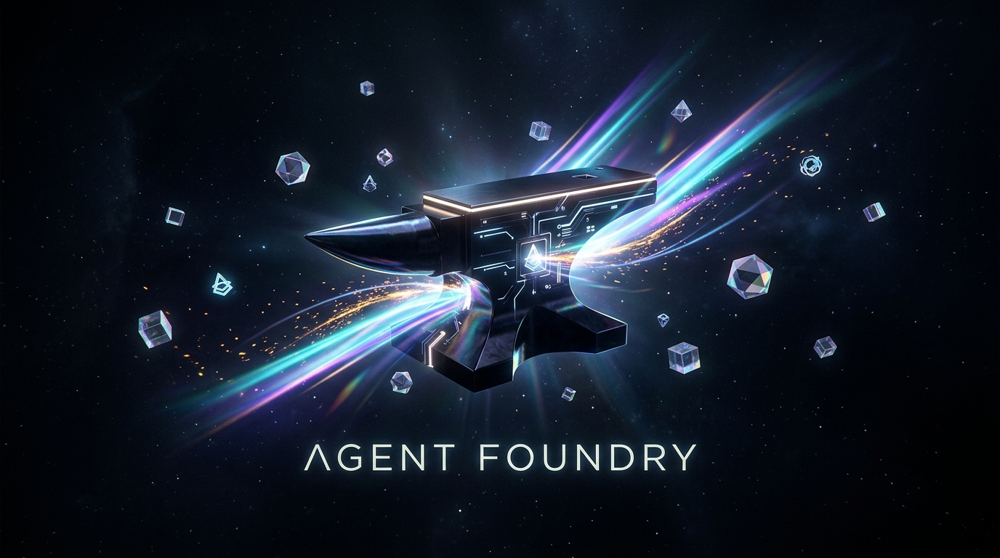
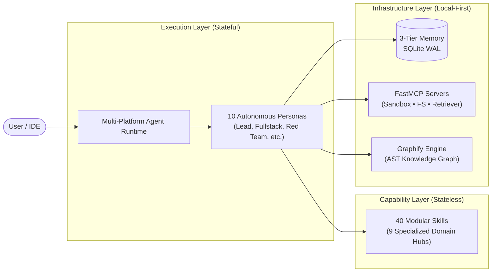

<div align="center">



# Agent Foundry — Local-First Workspace for Autonomous AI Agents

**Production-grade ecosystem of 10 Agent Personas, 40 Modular Skills, and 3 FastMCP Servers.**<br/>
*Zero cloud telemetry. 100% private. Compatible with Antigravity, OpenCode, Claude Code, and Codex.*

<br/>

[](./skills/README.md)
[](./agents/README.md)
[](./skills/README.md)
[](./LICENSE)

[](./memory/README.md)
[](./workflows/README.md)
[](./mcp_servers/README.md)
[](https://python.org)

<p align="center">
  <b>⚡ 100% ZERO-CLOUD ARCHITECTURE • AIR-GAPPED & PRIVATE ⚡</b>
</p>

[]()
[]()
[-E9C46A?style=for-the-badge)]()
[]()
[](./skills/rag-and-knowledge/graphify/SKILL.md)

</div>

---

## 🚀 Overview

**Agent Foundry** is a local-first engineering platform that equips AI coding assistants with **10 goal-driven agent personas**, **40 standardized operational skills**, **3 FastMCP tool servers**, a **3-tier persistent memory engine**, and an **AST-backed knowledge graph subsystem (Graphify)**.

Everything runs on your local machine with zero external telemetry, deterministic code validation, and progressive context disclosure.

---

## 🏛️ System Architecture



---

## ⚡ Core Components

### 1. Autonomous Agent Fleet (10 Personas)
Stateful actors configured with system prompts, memory retention policies, and specific skill bindings.
* **`lead-orchestrator`**: Master coordinator; DAG task decomposition and consensus debate.
* **`fullstack-engineer`**: Production feature implementation, REST/gRPC APIs, modern UI, and Docker.
* **`code-quality-auditor`**: Senior peer reviewer, 5-axis audits, and minimal failing bug reproductions.
* **`security-red-teamer`**: OWASP vulnerability scanning, prompt injection defense, and secret leakage prevention.
* **`data-scientist`**: EDA, leakage-safe ML feature pipelines, hypothesis testing, and SHAP explainability.
* **`browser-navigator`**: Playwright browser automation, DOM extraction, and visual verification.
* **`sre-devops-guardian`**: Multi-stage container hardening, zero-root enforcement, and CI/CD pipelines.
* **`finops-token-router`**: Dynamic model routing (cheap 8B vs reasoning models) and prompt caching.
* **`technical-writer-scribe`**: Architecture Decision Records (ADRs), 6-page narrative memos, and API docs.
* **`research-analyst`**: Exhaustive discovery, multi-source triangulation ($\ge 2$ sources), and briefs.

👉 *See full agent specifications in [`agents/README.md`](./agents/README.md).*

---

### 2. Operational Skills Hub (40 Skills Across 9 Domains)
Progressive-disclosure runbooks with step-by-step procedures, anti-pattern checklists, and verification tests:

| Domain Hub | Count | Highlights | Directory |
| :--- | :---: | :--- | :--- |
| **Data Science & ML** | 6 | Advanced analytics, feature engineering, hypothesis testing, SHAP | [`skills/data-analysis/`](./skills/data-analysis/) |
| **Orchestration & Governance** | 8 | Plan-and-execute, HITL governor, session handoff, LLM council, GSD | [`skills/orchestration/`](./skills/orchestration/) |
| **Software Engineering** | 6 | Backend architecture, frontend design, code reviewer, bug hunter, git | [`skills/software-engineering/`](./skills/software-engineering/) |
| **AI Security & Safety** | 3 | Vulnerability scanner, prompt injection red-teamer, guardrails enforcer | [`skills/ai-security-safety/`](./skills/ai-security-safety/) |
| **RAG & Knowledge Graphs** | 5 | **Graphify**, Agentic RAG (Self-RAG/CRAG), GraphRAG, MCP integrator | [`skills/rag-and-knowledge/`](./skills/rag-and-knowledge/) |
| **LLM Engineering & Evals** | 3 | Prompt architect, LLM evals engineer, vendor-neutral observability | [`skills/llm-engineering/`](./skills/llm-engineering/) |
| **Writing & Knowledge Capture** | 5 | **Humanizer (zero-AI)**, workspace researcher, knowledge capture | [`skills/writing-and-research/`](./skills/writing-and-research/) |
| **Data Engineering** | 3 | ELT pipelines (dbt/Airflow), vector database architect, event streaming | [`skills/database-and-data-engineering/`](./skills/database-and-data-engineering/) |
| **AI Product & UX** | 2 | Agentic UI streaming patterns, Amazon-style 6-page executive memos | [`skills/ai-product-and-ux/`](./skills/ai-product-and-ux/) |

👉 *Browse the complete catalog in [`skills/README.md`](./skills/README.md).*

---

### 3. Knowledge Graph Engine (Graphify)
Extracts local tree-sitter AST relationships across 20+ programming languages into persistent graphs:
* **Interactive HTML (`graphify-out/graph.html`)**: Visual network map of components and community clusters.
* **Audit Report (`graphify-out/GRAPH_REPORT.md`)**: Structural review highlighting god-nodes and couplings.
* **Queryable CLI**: Traverses code relationships via BFS/DFS (`/graphify query "..."`, `/graphify path "A" "B"`).

---

### 4. 3-Tier Persistent Memory Engine
Eliminates context amnesia across agent resets without cloud dependencies ([`memory/`](./memory/README.md)):
* **Tier 1 (Working)**: Fast in-memory RAM scratchpad for active turn tasks.
* **Tier 2 (Episodic)**: Append-only SQLite WAL ledger recording tool calls, latencies, and outcomes.
* **Tier 3 (Semantic)**: Long-term fact store with subword cosine similarity matching and anti-poisoning guardrails.

---

### 5. FastMCP Tool Servers & Workflows
* **FastMCP Servers ([`mcp_servers/`](./mcp_servers/README.md))**: Ready-to-run JSON-RPC tool endpoints for isolated Python code execution, safe filesystem access, and hybrid BM25 retrieval.
* **Declarative Workflows ([`workflows/`](./workflows/README.md))**: Zero-dependency DAG runner (`workflow_engine.py`) executing multi-step pipelines (`feature-factory`, `deep-research`, `self-healing-code`).

---

## 💻 Quick Start & Commands

```bash
# 1. Build codebase knowledge graph
/graphify .

# 2. Query code architecture without reading raw files
/graphify query "How do the agents interact with memory?"

# 3. Plan a high-complexity feature with risk scoring
/plan "Implement Redis semantic caching for FastMCP tool calls"

# 4. Humanize AI-generated text and comments
/humanizer "Review comments in auth_module.py"
```

---

## 🌐 Platform Integration

* **Google Antigravity**: Auto-discovered via [`.agents/rules/`](./.agents/rules/) and `~/.gemini/config/skills/`.
* **OpenCode**: Managed via commands in `%APPDATA%\opencode\commands\` and plugin hooks in [`.opencode/`](./.opencode/).
* **Claude Code**: Loaded globally via `~/.claude/skills/`.
* **Codex / Cursor**: Configured via [`AGENTS.md`](./AGENTS.md).

---

## 📂 Repository Layout

```text
├── .agents/                    # Workspace agent rules and workflows
├── .opencode/                  # OpenCode integration hooks and commands
├── agents/                     # 10 Autonomous agent personas and runtime
├── benchmarks/                 # Trajectory directness and autonomy gym
├── mcp_servers/                # FastMCP tool servers (Foundry, Sandbox, Filesystem)
├── memory/                     # 3-Tier persistent SQLite memory engine
├── skills/                     # 40 Modular operational skills across 9 domains
├── workflows/                  # Declarative multi-agent DAG pipelines
└── README.md                   # Master documentation
```

---

<div align="center">
  <sub>Built for precision, safety, and autonomy. Zero cloud telemetry. Local-first.</sub>
</div>
