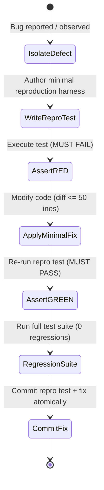

# Canonical Testing Architecture & Verification Standards

This reference defines testing discipline across the engineering lifecycle, including the Test Pyramid, the "Prove-It" Bug Reproduction Pattern, and test hygiene standards.

---

## 1. The 80 / 15 / 5 Test Pyramid

```
           / \
          / 5% \      E2E / Browser Tests (Critical user journeys only)
         /------\
        /  15%   \    Integration Tests (Service boundaries, DB transactions, API contracts)
       /----------\
      /    80%     \  Unit Tests (Pure functions, domain logic, boundary edge cases, fast)
     /--------------\
```

### Allocation Rules:
- **80% Unit Tests**: Fast, in-memory, deterministic, zero network or disk dependencies. Validate individual components, functions, data transformers, and validators.
- **15% Integration Tests**: Validate interactions between modules, database transactions, cache lookups, and message serialization. Use ephemeral test databases or in-process mock servers.
- **5% End-to-End (E2E) Tests**: High-value smoke journeys. Test complete user flows from entry point to persistence. Keep these lean to avoid flakiness and high CI run times.

---

## 2. The "Prove-It" Bug Reproduction Pattern

Never fix a bug without first authoring a test that proves the defect exists. Speculative fixes that modify code before producing a failing test are strictly prohibited.



### The 4 Steps of Prove-It:
1. **Isolate**: Strip away peripheral application state. Create a standalone test case (e.g., in `tests/repros/test_issue_<id>.py`).
2. **Assert RED (Verify Failure)**: Run the test. Confirm it fails with the exact stack trace or assertion failure observed in production.
3. **Apply Minimal Fix**: Write the minimal code necessary to make the reproduction test turn green. Do not perform unrelated refactoring.
4. **Assert GREEN (Verify Pass)**: Run the reproduction test and confirm exit code 0. Run the entire regression suite to confirm no regressions.

---

## 3. Test Isolation & Hygiene Principles

- **Zero Global State Bleed**: Every test must set up and tear down its own state. Tests must be order-independent (`pytest -n auto` or randomized execution must pass).
- **No Hardcoded Sleeps**: Never use `time.sleep()` or `setTimeout()` to wait for asynchronous operations. Use deterministic polling primitives (e.g., `waitForCondition`, `await expect(locator).toBeVisible()`).
- **Hermetic Mocks**: Mock only at the boundaries of system ownership (third-party payment gateways, external email APIs, external LLM endpoints). Do not mock internal domain objects.
- **Boundary Exhaustion**: For numerical or string inputs, test the minimum boundary, maximum boundary, null/empty, off-by-one, and malformed characters.

---

## 4. Test Verification Command Suite

Execute the appropriate test runner command for the active technology stack:

| Framework | Unit Test Command | Integration / E2E Command | Coverage Check |
|:---|:---|:---|:---|
| **Python / Pytest** | `pytest tests/unit/ -v` | `pytest tests/integration/ -v` | `pytest --cov=src --cov-fail-under=85` |
| **Node / Jest / Vitest** | `npm test -- --run` | `npm run test:e2e` | `npm test -- --coverage` |
| **Rust / Cargo** | `cargo test --lib` | `cargo test --test '*'` | `cargo tarpaulin` |
| **Go** | `go test -v ./...` | `go test -v -tags=integration ./...` | `go test -cover ./...` |
