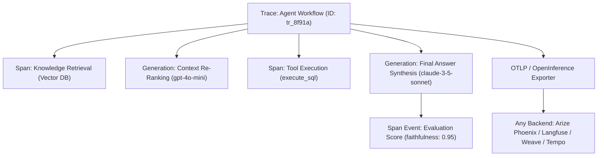

# LLM Observability & Distributed Agent Tracing

## Overview

Instruments AI agents, LLM pipelines, and tool calls with vendor-neutral distributed tracing and observability. Implements OpenTelemetry GenAI semantic conventions, token burn tracking, latency profiling, and error attribution across Langfuse, Phoenix, or Datadog.

## When to Use

- Instrumenting multi-agent workflows with end-to-end distributed tracing across steps and tools.
- Capturing hierarchical call trees: Agent Reasoning $\rightarrow$ Tool Execution $\rightarrow$ Vector Retrieval $\rightarrow$ LLM Generation.
- Tracking token economics (input/output tokens, dollar cost) across model providers.
- Measuring Golden Signals: **Time to First Token (TTFT)**, **Throughput** (tokens/sec), and **Latency breakdowns**.
- Redacting PII (emails, SSNs, credit cards) before traces are exported to log collectors.
- Logging evaluation scores (faithfulness, hallucination, user ratings) directly attached to trace IDs.

---
- **When NOT to use**: Traditional host infrastructure CPU/RAM monitoring (use `sre-devops-guardian`), or purely offline prompt benchmarking (use `llm-evals-engineer`).

## Core Process & Telemetry Instrumentation

## Core Architecture: Hierarchical Tracing Model



### Standard GenAI Semantic Conventions Attributes

| Attribute Name | Type | Description / Example |
| :--- | :--- | :--- |
| `gen_ai.system` | `string` | Provider identifier (`openai`, `anthropic`, `google`, `ollama`) |
| `gen_ai.request.model` | `string` | Requested model name (`gpt-4o`, `claude-3-5-sonnet`) |
| `gen_ai.usage.prompt_tokens` | `int` | Prompt / input token count (`420`) |
| `gen_ai.usage.completion_tokens` | `int` | Completion / output token count (`180`) |
| `gen_ai.usage.cost_usd` | `double` | Calculated USD cost based on model pricing |
| `openinference.span.kind` | `string` | `AGENT`, `CHAIN`, `LLM`, `TOOL`, `RETRIEVER`, `RERANKER` |

---

## Quickstart Integration Pattern

A complete, production-ready telemetry engine is available at [`scripts/telemetry_engine.py`](./scripts/telemetry_engine.py). 

Import and wrap your agent steps using standard context managers:

```python
from scripts.telemetry_engine import LLMObservabilityManager

telemetry = LLMObservabilityManager(service_name="agent-service", environment="production")

# 1. Trace the overall agent conversation / turn
with telemetry.trace_agent_workflow("research_agent", user_id="usr_102", session_id="sess_404"):
    
    # 2. Trace deterministic tool execution
    with telemetry.trace_tool_execution("web_search", {"query": "Q3 AI earnings"}) as tool_rec:
        tool_rec["output"] = "Retrieved 3 financial news sources..."

    # 3. Trace LLM generation with token counts and latency
    with telemetry.trace_llm_generation(
        span_name="synthesize_findings",
        model="gpt-4o",
        user_prompt="Summarize the earnings report."
    ) as llm_rec:
        # LLM call happens here
        llm_rec["completion"] = "Tech earnings rose 14% year-over-year..."
        llm_rec["prompt_tokens"] = 450
        llm_rec["completion_tokens"] = 120
        llm_rec["ttft_seconds"] = 0.38
```

---

## Zero-Code Backend Configuration

Telemetry exports via standard OpenTelemetry OTLP protocol. Change destinations simply by setting environment variables—no code changes required:

| Observability Backend | Required Environment Variables |
| :--- | :--- |
| **Arize Phoenix (Local / Self-Hosted)** | `OTEL_EXPORTER_OTLP_ENDPOINT="http://localhost:4317"`<br>`OTEL_EXPORTER_OTLP_PROTOCOL="grpc"` |
| **Langfuse (Cloud or Self-Hosted)** | `OTEL_EXPORTER_OTLP_ENDPOINT="https://us.cloud.langfuse.com/api/public/otel"`<br>`OTEL_EXPORTER_OTLP_HEADERS="Authorization=Basic <base64(pk:sk)>"` |
| **Weights & Biases Weave / Arize AI** | `OTEL_EXPORTER_OTLP_ENDPOINT="https://otlp.arize.com/v1"`<br>`OTEL_EXPORTER_OTLP_HEADERS="space_id=...,api_key=..."` |
| **Datadog / Grafana Tempo / Honeycomb** | `OTEL_EXPORTER_OTLP_ENDPOINT="http://otel-collector.internal:4317"` |

---

## Bundled Helper Assets

- [`scripts/telemetry_engine.py`](./scripts/telemetry_engine.py): Standalone, typed telemetry manager with PII regex redaction, pricing calculation for OpenAI/Anthropic/Gemini, and evaluation score attachment.

## Common Rationalizations

| Rationalization | Reality |
|---|---|
| *"Standard application logs (`console.log`, `print`) are sufficient for LLMs."* | Linear text logs cannot represent hierarchical multi-agent DAG execution, tool nesting, token costs, or prompt/completion payloads. |
| *"Tracing adds excessive network latency to user-facing streaming."* | Asynchronous non-blocking OTLP exporters queue spans in memory and flush batches in background threads with zero UI latency impact. |
| *"We don't need token tracking because our API quota is large."* | Undetected prompt bloat or infinite agent tool loops can burn thousands of dollars in minutes without per-request token telemetry. |
| *"Logging user prompts doesn't violate privacy if it's internal."* | Unsanitized telemetry spans leak user PII, credentials, and confidential business documents into monitoring SaaS dashboards. |

## Red Flags

- Agent tool calls executing without parent-span trace IDs, making multi-turn failures impossible to reconstruct.
- Missing token count and cost attribution tags on model generation spans.
- Synchronous telemetry exports blocking the main event loop.
- Unmasked PII or API secrets persisted in OpenTelemetry trace payloads.

## Verification

After completing the workflow, confirm:
- [ ] Hierarchical trace spans cleanly separate root sessions, workflow steps, tool calls, and model generations.
- [ ] Token usage (input, completion, cached) and latency are tracked per request.
- [ ] OpenTelemetry GenAI semantic conventions (`gen_ai.system`, `gen_ai.request.model`) are adhered to.
- [ ] Tracing engine passes self-test: `python skills/llm-engineering/llm-observability/scripts/telemetry_engine.py`.
