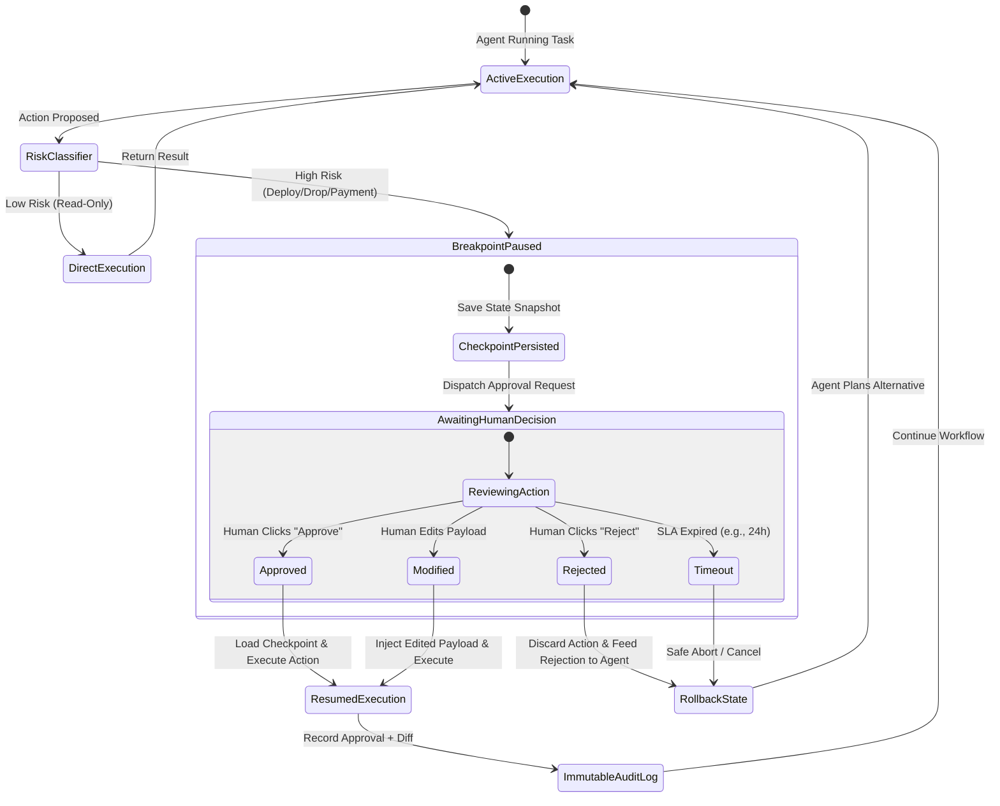

# Human-in-the-Loop (HITL) Governor & Policy Gate

## Overview

Enforces human-in-the-loop (HITL) approval gates, pause-and-resume execution flows, and audit controls for autonomous agents. Guards high-risk actions (production deploys, payments, irreversible data deletion) against uncontrolled execution.

## When to Use

- When an agent is about to execute a destructive or irreversible action:
  - Database mutations (`DROP`, `DELETE`, migration scripts).
  - Financial operations (initiating payments, modifying billing tiers).
  - Infrastructure changes (cloud resource provisioning, deploying to production).
  - External communication (broadcasting emails, publishing social posts).
- When designing workflow state machines with pause/resume requirements.
- Trigger phrases: `"human in the loop"`, `"approval gate"`, `"require user confirmation"`, `"safe execution policy"`, `"checkpoint agent"`.

---
- **When NOT to use**: Read-only research queries or purely local scratch file generation.

## Core Process & HITL Governance Architecture

## Execution Lifecycle & Risk Classification



### Risk Tiers & Control Gates

| Tier Level | Action Category | Required Control Gate |
| :--- | :--- | :--- |
| 🟢 **Tier 1: Low** | Read-Only (Fetch, Search, Read, Profiling) | Fully Autonomous |
| 🟡 **Tier 2: Medium** | Staging Writes (Scratch files, Draft PRs) | Automated Notification / Event Log |
| 🔴 **Tier 3: High** | Destructive / Production Ops (Deploy, Drop, Payments) | Hard Breakpoint & Human Approval Required |

---

## HITL Implementation Patterns

### 1. State Checkpointing & Interrupts (LangGraph Pattern)
Before dispatching a high-risk tool node, interrupt the execution graph and persist state:
```python
from langgraph.checkpoint.sqlite import SqliteSaver
from langgraph.graph import StateGraph

# Configure checkpointer
memory = SqliteSaver.from_conn_string(":memory:")

# Interrupt before the production deploy node
workflow.compile(
    checkpointer=memory,
    interrupt_before=["deploy_to_production_node"]
)
```

### 2. The Approval Request Envelope
When pausing execution, present a structured approval request to the human operator:

```markdown
### ⚠️ Human Approval Required: [Operation Name]

**Risk Level**: 🔴 High (Tier 3)
**Action**: Deploying commit `7a81c2` to production cluster `us-east-1`.
**Estimated Blast Radius**: Affects 12,000 active web sessions.

#### Proposed Payload / Diff:
```diff
- IMAGE_TAG=v1.4.2
+ IMAGE_TAG=v1.5.0
```

#### Verification Steps Completed by Agent:
- [x] All 84 unit and integration tests passed.
- [x] Staging smoke tests green.
- [x] Database migration dry-run completed with zero data loss.

**Decision Required**: Please confirm with `APPROVE` or reject with `REJECT: [Reason]`.
```

### 3. Signed Audit Logging
Record every human decision with metadata:
- Timestamp, user identity, action hash, and agent rationale.
- Never proceed if the human response is ambiguous; require explicit confirmation.

## Common Rationalizations

| Rationalization | Reality |
|---|---|
| *"The agent asked for permission once at the beginning, so it can run all sub-tasks autonomously."* | Initial intent approval is not approval for dangerous intermediate sub-actions (e.g. dropping a table or spending money). |
| *"Asking for human approval slows down the agent's workflow."* | A 10-second human confirmation prevents catastrophic irreversible database drops, accidental git force-pushes, and financial loss. |
| *"We can use an automated LLM judge instead of a human for approval."* | LLM judges share identical failure modes and prompt injection vulnerabilities as the agent; true governance requires human judgment. |
| *"Read-only tools never need approval gates."* | Tools that read sensitive credentials or export private customer data require approval gates to prevent data exfiltration. |

## Red Flags

- Agent executing shell commands with `rm -rf`, `DROP TABLE`, or `git push --force` without an explicit approval prompt.
- Approval requests that show vague summaries without displaying the exact diff or command to be run.
- Bypassing policy gates when an API call times out or throws an error.
- Executing financial transactions or external email dispatch without user confirmation.

## Verification

After completing the workflow, confirm:
- [ ] All tools and actions are classified into risk tiers (READ_ONLY, LOW, MEDIUM, HIGH, CRITICAL).
- [ ] High-risk and critical actions pause execution and prompt the user with exact diffs and commands.
- [ ] Audit log records who approved the action, the timestamp, and the exact payload approved.
- [ ] Policy engine prevents execution if the human denies or modifies the requested action.
