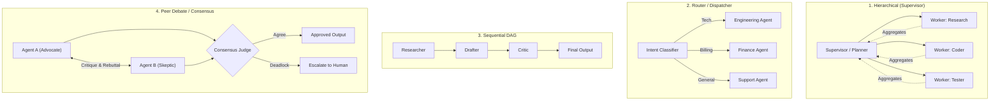

# Multi-Agent Orchestrator & Swarm Architect

## Overview

Designs, implements, and coordinates multi-agent systems and agent swarm topologies (Hierarchical, Router, Peer Consensus, Sequential DAG). Manages shared state, task handoffs, loop prevention, and termination guarantees.

## When to Use

- When designing systems with 2 or more specialized cooperating agents.
- When selecting an agent topology (Supervisor/Worker, Peer Debate, Router/Dispatcher, Sequential Pipeline).
- When debugging agent swarms stuck in infinite ping-pong loops or hallucinated delegating traps.
- When structuring shared state, checkpointing, and agent-to-agent (A2A) message protocols.
- Trigger phrases: `"multi-agent system"`, `"agent swarm"`, `"orchestrate agents"`, `"LangGraph workflow"`, `"CrewAI setup"`, `"agent collaboration"`.
- **When NOT to use**: Single-agent prompt engineering or simple linear script execution.

## Core Process & Multi-Agent Swarm Architecture

## Core Multi-Agent Topologies



1. **Hierarchical (Supervisor/Workers)**: One planner coordinates worker subagents, aggregates results, and validates completion. Best for complex, multi-faceted projects.
2. **Router / Dispatcher**: Single classification node routes user intent to one specialized domain agent. Best for customer support and triage.
3. **Sequential Pipeline DAG**: Agent output feeds directly into the next agent's input as an assembly line. Best for content generation and code review gates.
4. **Peer Debate / Consensus**: Multiple agents independently solve a problem, critique each other, and vote on the final answer. Best for high-stakes mathematical or legal reasoning.

---

## The 4 Invariants of Safe Multi-Agent Systems

1. **Explicit Termination Guarantees**: Every multi-agent loop must have a hard `max_iterations` counter and a deterministic exit condition.
2. **Typed Shared State**: Shared state must use a validated schema (e.g., Pydantic model or TypedDict), not unvalidated free-form dictionaries.
3. **Bounded Delegation**: Prevent subagents from spawning infinite descendants. Cap delegation depth at 2 or 3 levels max.
4. **Isolated Memory Contexts**: Do not pass the entire conversation history to all subagents. Filter state to only what each worker needs to minimize context exhaustion and noise.

---

## Step-by-Step Orchestration Workflow

### Step 1: Define the Shared State Schema
```python
from typing import TypedDict, Annotated, List
import operator

class AgentState(TypedDict):
    task: str
    plan: List[str]
    research_notes: str
    draft_code: str
    # Use operator.add reducer so worker subagents append comments without overwriting
    review_comments: Annotated[List[str], operator.add]
    iteration_count: int
    is_approved: bool
```

### Step 2: Implement Nodes & Transitions
- Each node represents an isolated agent with a specific role, system prompt, and toolset.
- Transitions must be deterministic conditional edges:
  ```python
  def should_continue(state: AgentState) -> str:
      if state["is_approved"] or state["iteration_count"] >= 5:
          return "end"
      return "engineer"
  ```

### Step 3: Loop Prevention & Circuit Breakers
- If an agent generates the exact same tool call or output twice consecutively, trigger a circuit breaker and escalate to the supervisor.
- Log message traces between agents with correlation IDs for observability.

## Common Rationalizations

| Rationalization | Reality |
|---|---|
| *"More agents are always better than one agent."* | Unnecessary multi-agent complexity inflates latency, multiplies API token costs, and introduces fragile communication failure points. |
| *"Agents can communicate via free-form conversational text."* | Free-form chat between agents causes conversational drift and parsing failures; agents must communicate via typed JSON message envelopes. |
| *"A central orchestrator can handle 50 agents simultaneously."* | Monolithic orchestrators become massive context bottlenecks; hierarchical sub-teams or isolated DAGs are required at scale. |
| *"Termination conditions aren't needed if the prompt says 'stop when done'."* | Autonomous agent swarms enter infinite conversational loops without deterministic step limits and termination predicates. |

## Red Flags

- Agents exchanging informal greetings ('Hello Agent B, I have your task') instead of structured JSON payloads.
- Missing maximum turn limits (e.g. `max_iterations = 10`), risking runaway API billing.
- Circular delegation loops where Agent A delegates to Agent B who delegates back to Agent A.
- State mutations shared across agents without concurrency locks or transactional boundaries.

## Verification

After completing the workflow, confirm:
- [ ] Swarm topology (DAG, Hierarchical, Router) is explicitly selected based on task dependency analysis.
- [ ] Agent communications use typed message schemas with correlation IDs.
- [ ] Hard termination conditions and loop-detection breakers are active and tested.
- [ ] Workflow engine validates step completion against formal acceptance criteria: `python workflows/workflow_engine.py --test`.
