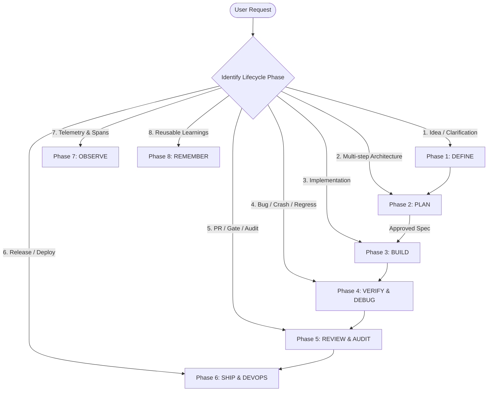

# Using Agent Skills: Foundry Operating System & Router

## Overview

This skill is the central routing and governance engine of the Agent Foundry ecosystem. It establishes the foundational operating discipline that governs all agent behavior: **Process, not prose.** Skills are not passive documentation; they are strict, state-machine workflows that agents must follow step-by-step.

### The 3 Non-Negotiables
1. **Anti-Rationalization**: Agents naturally rationalize skipping tests, making massive diffs, or guessing requirements. Every skill establishes strict rebuttals to common excuses.
2. **Verification is Evidence**: "Code looks good" or "I believe this works" never passes. Verification demands fresh, empirical proof: test runner exit code 0, clean compiler output, diff line counts, or captured runtime logs.
3. **Progressive Disclosure**: Keep tokens lean. At startup, only skill names and descriptions are in context. Full `SKILL.md` instructions load only upon trigger, and `references/` checklists load only when performing that phase.

---

## The 6 Global Operating Rules

Every agent operating within this repository must adhere strictly to these six rules at all times:

```
┌────────────────────────────────────────────────────────────────────────┐
│                      THE 6 GLOBAL OPERATING RULES                      │
├────────────────────────────┬───────────────────────────────────────────┤
│ 1. Surface Assumptions     │ State unverified prerequisites upfront    │
│ 2. Stop on Confusion       │ Halt execution immediately when blocked   │
│ 3. Push Back               │ Challenge bad patterns; ask Socratic Qs   │
│ 4. Enforce Simplicity      │ YAGNI; avoid premature generalization     │
│ 5. Scope Discipline        │ Zero drive-by refactorings outside slice  │
│ 6. Verify with Evidence    │ Require runnable proof before completion  │
└────────────────────────────┴───────────────────────────────────────────┘
```

1. **Surface Assumptions Early**: Never silently infer ambiguous user requirements, default configurations, or API signatures. State assumptions explicitly before modifying files.
2. **Stop on Confusion**: When encountering conflicting requirements, missing environment variables, or unexpected test failures, **STOP IMMEDIATELY**. Do not guess, paper over errors with try/catch, or speculate.
3. **Push Back When Appropriate**: Practice the Socratic challenge. If the user asks for an anti-pattern (e.g., bypassing type safety, skipping migrations, or giant monomorphs), explain the architectural trade-off and offer a cleaner alternative. Respect Chesterton's Fence: understand why existing code was written before tearing it down.
4. **Enforce Simplicity**: Solve the immediate problem cleanly. Do not invent multi-layered abstractions, unnecessary generic types, or speculative configurations for hypothetical future requirements. Files should strive to stay under 500 lines.
5. **Scope Discipline**: Keep diffs tight. Never fix unrelated typos, reformat untouched files, or alter code style outside the immediate task slice. Maximum ~100–150 changed lines per commit.
6. **Verify with Evidence**: A task is never complete until fresh execution evidence is captured. Run the test suite, verify exit code 0, check linter output, and assert runtime behavior.

---

## Complete Lifecycle Decision Tree



### Phase 1: DEFINE (Problem Discovery & Scoping)
*Goal: Turn vague ideas into unambiguous contracts before writing a single line of plan or code.*
- **Ambiguous project or feature idea**: $\to$ [`brainstorming`](../../orchestration/brainstorming/SKILL.md)
- **High-stakes stakeholder brief / PRD**: $\to$ [`executive-memo-architect`](../../ai-product-and-ux/executive-memo-architect/SKILL.md)
- **Extracting decisions from meetings/notes**: $\to$ [`knowledge-capture`](../../writing-and-research/knowledge-capture/SKILL.md)
- **Dangerous or irreversible production operations**: $\to$ [`human-in-the-loop-governor`](../../orchestration/human-in-the-loop-governor/SKILL.md)
- **Persona to consult**: `@lead-orchestrator` or `@research-analyst`

### Phase 2: PLAN (Architectural Decomposition & Gating)
*Goal: Deconstruct work into small, verifiable tasks with explicit rollback points. Always STOP after spec.*
- **Complex multi-step engineering task**: $\to$ [`plan-and-execute`](../../orchestration/plan-and-execute/SKILL.md) (Gated: SPEC $\to$ PLAN $\to$ TASKS $\to$ IMPLEMENT)
- **Multi-day codebase exceeding context window**: $\to$ [`get-shit-done`](../../orchestration/get-shit-done/SKILL.md) (3-Tier: Project $\to$ Milestone $\to$ Slice $\to$ Task)
- **Multi-agent coordination or delegation**: $\to$ [`multi-agent-orchestrator`](../../orchestration/multi-agent-orchestrator/SKILL.md)
- **Context reset or handoff between sessions**: $\to$ [`session-handoff`](../../orchestration/session-handoff/SKILL.md)
- **Persona to consult**: `@lead-orchestrator`

### Phase 3: BUILD (Modular, High-Velocity Implementation)
*Goal: Implement vertical slices with micro-commits (<100–150 lines per slice).*
- **REST/gRPC APIs, microservices, connection pools**: $\to$ [`backend-architecture`](../../software-engineering/backend-architecture/SKILL.md)
- **Modern UI aesthetics, design systems, CSS polish**: $\to$ [`frontend-design`](../../software-engineering/frontend-design/SKILL.md)
- **Streaming AI UX, markdown repair, thought accordions**: $\to$ [`agentic-ui-patterns`](../../ai-product-and-ux/agentic-ui-patterns/SKILL.md)
- **ETL, Airflow/Dagster, Kimball star schemas**: $\to$ [`data-pipeline-etl`](../../database-and-data-engineering/data-pipeline-etl/SKILL.md)
- **Vector search, ANN indexing (HNSW, IVFFlat)**: $\to$ [`vector-database-architect`](../../database-and-data-engineering/vector-database-architect/SKILL.md)
- **Kafka / Redis Streams event-driven pipelines**: $\to$ [`streaming-and-event-driven`](../../database-and-data-engineering/streaming-and-event-driven/SKILL.md)
- **FastMCP server creation & Pydantic tool schemas**: $\to$ [`mcp-tool-integrator`](../../rag-and-knowledge/mcp-tool-integrator/SKILL.md)
- **Prompt authoring & few-shot XML templates**: $\to$ [`prompt-architect`](../../llm-engineering/prompt-architect/SKILL.md)
- **Leakage-safe ML feature pipelines**: $\to$ [`feature-engineering-pipeline`](../../data-analysis/feature-engineering-pipeline/SKILL.md)
- **Persona to consult**: `@fullstack-engineer`

### Phase 4: VERIFY & DEBUG (Evidence-Based Testing)
*Goal: Prove behavior with deterministic, reproducible test cases. Never speculate.*
- **Runtime crashes, exceptions, race conditions**: $\to$ [`bug-hunter`](../../software-engineering/bug-hunter/SKILL.md) (Prove-It pattern: RED $\to$ GREEN)
- **E2E browser flows, visual regressions, DOM verification**: $\to$ [`workspace-researcher`](../../writing-and-research/workspace-researcher/SKILL.md)
- **Statistical hypotheses & A/B testing**: $\to$ [`statistical-hypothesis-tester`](../../data-analysis/statistical-hypothesis-tester/SKILL.md)
- **LLM-as-a-judge & model output evaluation**: $\to$ [`llm-evals-engineer`](../../llm-engineering/llm-evals-engineer/SKILL.md)
- **Persona to consult**: `@code-quality-auditor` or `@browser-navigator`

### Phase 5: REVIEW & AUDIT (Quality Gates)
*Goal: Senior staff peer review across Correctness, Readability, Architecture, Security, Performance.*
- **5-Axis code review & diff gate**: $\to$ [`code-reviewer`](../../software-engineering/code-reviewer/SKILL.md) (referencing `references/done.md`)
- **OWASP Top 10, secret leaks, SQLi/SSRF**: $\to$ [`security-vulnerability-scanner`](../../ai-security-safety/security-vulnerability-scanner/SKILL.md)
- **Prompt injection, jailbreak resistance**: $\to$ [`prompt-injection-red-teamer`](../../ai-security-safety/prompt-injection-red-teamer/SKILL.md)
- **Runtime PII sanitization & input guardrails**: $\to$ [`guardrails-enforcer`](../../ai-security-safety/guardrails-enforcer/SKILL.md)
- **Agent execution loops & tool call directness**: $\to$ [`agent-trajectory-evaluator`](../../orchestration/agent-trajectory-evaluator/SKILL.md)
- **SHAP values, fairness & algorithmic bias**: $\to$ [`model-explainability-shap`](../../data-analysis/model-explainability-shap/SKILL.md)
- **Persona to consult**: `@code-quality-auditor` or `@security-red-teamer`

### Phase 6: SHIP & DEVOPS (Hardening & Releasing)
*Goal: Zero-regression release, multi-stage containers, and clean documentation.*
- **Multi-stage, rootless, hardened Docker builds**: $\to$ [`docker-container-architect`](../../software-engineering/docker-container-architect/SKILL.md)
- **Atomic commits, branch rebasing, worktrees**: $\to$ [`git-plumbing-and-automation`](../../software-engineering/git-plumbing-and-automation/SKILL.md)
- **Office doc generation (Word, Excel, PDF)**: $\to$ [`office-doc-engine`](../../writing-and-research/office-doc-engine/SKILL.md)
- **De-slopping and programmatic text/code humanization**: $\to$ [`humanizer`](../../writing-and-research/humanizer/SKILL.md)
- **Persona to consult**: `@sre-devops-guardian` or `@technical-writer-scribe`

### Phase 7: OBSERVE (Distributed Telemetry)
*Goal: OpenTelemetry tracing, latency profiling, and token burn monitoring.*
- **Trace agent spans, model costs, and latencies**: $\to$ [`llm-observability`](../../llm-engineering/llm-observability/SKILL.md)
- **Persona to consult**: `@finops-token-router`

### Phase 8: REMEMBER (Cross-Session Knowledge)
*Goal: Store reusable patterns in persistent SQLite memory.*
- **3-Tier memory management (Working, Episodic, Semantic)**: $\to$ [`agent-memory-architect`](../../rag-and-knowledge/agent-memory-architect/SKILL.md)

---

## Fast-Path Shortcuts

| Workflow | Sequence of Skills |
|:---|:---|
| **Bug Fix Shortcut** | `bug-hunter` (Prove-It repro test) $\to$ `backend-architecture` (fix) $\to$ `code-reviewer` |
| **New Feature Delivery** | `brainstorming` $\to$ `plan-and-execute` (STOP-after-spec) $\to$ `fullstack-engineer` $\to$ `code-reviewer` $\to$ `references/done.md` |
| **Code Simplification** | `code-reviewer` $\to$ Chesterton's Fence audit $\to$ atomic refactor (<100 lines) $\to$ regression test verification |
| **Data Exploration** | `eda-and-data-cleaning` $\to$ `advanced-data-analyst` $\to$ `statistical-hypothesis-tester` $\to$ `executive-memo-architect` |
| **Production Release Gate** | `/ship` fan-out $\to$ parallel review (`code-quality-auditor` + `security-red-teamer` + `sre-devops-guardian`) $\to$ `lead-orchestrator` Go/No-Go |

---

## The 3-Layer Composition Standard

```
┌────────────────────────────────────────────────────────┐
│ COMMAND / ORCHESTRATOR (When to run: User / Slash Cmd) │
└──────────────────────────┬─────────────────────────────┘
                           │ Dispatches
                           ▼
┌────────────────────────────────────────────────────────┐
│ PERSONA (Who is running: Autonomous Specialist Actor)  │
└──────────────────────────┬─────────────────────────────┘
                           │ Executes
                           ▼
┌────────────────────────────────────────────────────────┐
│ SKILL (How to do it: Stateless, Step-by-Step SOP)      │
└────────────────────────────────────────────────────────┘
```

1. **Personas NEVER invoke personas**: Specialist personas must never dispatch or invoke other personas. Meta-orchestrator intermediaries (agents orchestrating agents) are strictly forbidden to eliminate 2x token inflation and routing thrashing.
2. **User-Driven Sequential Lifecycle**: Workflow progression is driven directly by the user or slash commands: `/spec` $\to$ `/plan` $\to$ `/build` $\to$ `/review` $\to$ `/ship`.
3. **The Single Authorized Fan-Out**: The ONLY permitted parallel multi-agent execution is the `/ship` release gate: the `/ship` command or user fans out concurrently to `@code-quality-auditor`, `@security-red-teamer`, and `@sre-devops-guardian`, then fans back in to merge findings into a single Go/No-Go verdict.

> [!NOTE]
> **Portability Guarantee (Issue #361 Mitigation)**: All shared checklists are colocated in both root `references/` and `./references/` inside each skill package, ensuring relative links resolve whether skills are executed inside a monorepo or deployed individually.

---

## Common Rationalizations

| Rationalization | Reality |
|---|---|
| *"The user's prompt is obvious; I don't need to surface assumptions."* | "Obvious" prompts have the highest rate of hidden mismatch. State assumptions explicitly before modifying files. |
| *"I will write the code first, and create tests and specs after it works."* | Code written without tests and specifications accumulates untested edge cases and violates the STOP-after-spec gate. |
| *"I can refactor this messy module while implementing the new endpoint."* | Drive-by refactoring causes merge conflicts, obscures git bisect, and violates scope discipline. Keep diffs under 150 lines. |
| *"The change is small, so running the test suite isn't necessary."* | Small changes break production systems daily. Verification is evidence: always run the tests and record output. |

---

## Red Flags

- Beginning implementation without explicit approval of a specification or plan.
- Diffs exceeding 150 lines across unrelated files in a single step.
- Claiming a task is complete based on intuition without executing verification commands.
- A specialist persona invoking another specialist persona directly.
- Continuing execution when an unexpected error or missing prerequisite is encountered.

---

## Verification

Before declaring any lifecycle task complete, confirm:
- [ ] Appropriate skill was activated based on the lifecycle decision tree.
- [ ] All 6 Global Operating Rules were honored throughout execution.
- [ ] STOP-after-spec gate was observed prior to modifying files.
- [ ] Changes adhered to the ~100–150 line diff budget.
- [ ] Fresh execution evidence (test output, exit code 0) was produced and recorded.
