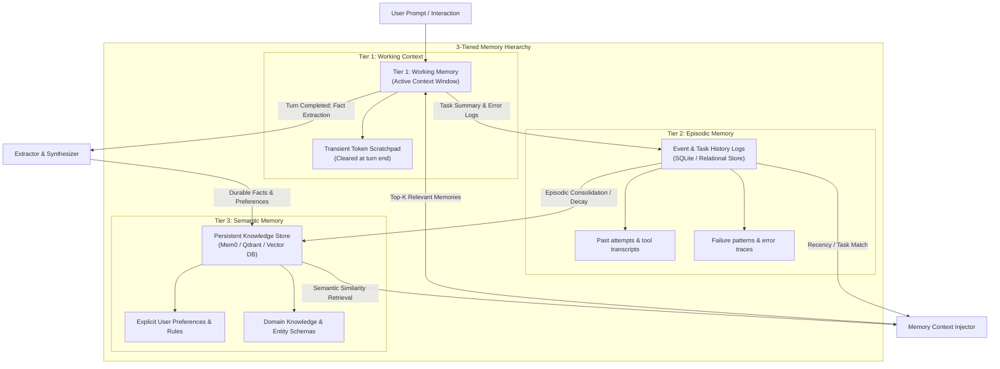

# Agent Memory Architect & Context Engine

## Overview

Architects and manages tiered agent memory systems: Tier 1 (Working Memory / scratchpads), Tier 2 (Episodic Memory / SQLite execution logs), and Tier 3 (Semantic Memory / vector facts). Prevents memory poisoning, memory bloat, and context thrashing.

## When to Use

- When building AI agents that require state and memory across multiple days or conversations.
- When selecting or configuring memory frameworks (`Mem0`, `Cognee`, `Zep`, vector databases).
- When designing semantic search, fact extraction, and memory decay/summarization algorithms.
- When protecting an agent's memory store from memory poisoning or conflicting obsolete facts.
- Trigger phrases: `"agent memory"`, `"persistent memory"`, `"Mem0 integration"`, `"remember user preferences"`, `"episodic memory"`.

---
- **When NOT to use**: Relational database schema optimization (use `backend-architecture`) or general RAG document retrieval (use `agentic-rag-engineer`).

## Core Process & 3-Tier Memory Implementation

## The 3-Tiered Memory Architecture



### Memory Tier Breakdown

| Memory Tier | Storage Backend | Durability | Content & Scope |
| :--- | :--- | :--- | :--- |
| **Tier 1: Working Memory** | LLM Context Window | Single Turn / Task | Active system prompt, immediate user input, scratchpad tokens. Cleared when turn concludes. |
| **Tier 2: Episodic Memory** | SQLite / Document DB | Session / Project | Task histories, past execution failures, what was previously attempted. |
| **Tier 3: Semantic Memory** | Vector Store (Mem0/Qdrant) | Cross-Session Persistent | Durable user habits, domain rules, extracted facts, and entity graphs. |

---

## Step-by-Step Memory Implementation

### Step 1: Fact Extraction & Memory Ingestion
After each completed conversation or major milestone, run an extraction prompt to distill durable facts from transient chat filler:
```python
extraction_prompt = """
Extract durable facts, explicit user preferences, and architectural decisions
from the following conversation. Ignore temporary greetings and transient errors.
Output as a list of concise declarative statements.
"""
```

### Step 2: Semantic Memory Storage (Mem0 / Vector Store)
Store facts with metadata (timestamp, source session, category):
```python
from mem0 import Memory

# Initialize Memory Engine
memory = Memory()

# Add user fact
memory.add(
    "User prefers TypeScript over JavaScript and uses strict null checks",
    user_id="developer_123",
    metadata={"category": "coding_style", "confidence": 0.95}
)
```

### Step 3: Dynamic Context-Aware Retrieval
At the beginning of each turn, query the memory store using the user's active prompt:
```python
relevant_memories = memory.search(query=user_prompt, user_id="developer_123", limit=5)

# Inject only relevant facts into system prompt (Mem0 returns 'memory' key)
memory_context = "\n".join([f"- {m.get('memory', m.get('text', ''))}" for m in relevant_memories])
system_prompt = f"Relevant User Context:\n{memory_context}\n\nTask: ..."
```

### Step 4: Conflict Resolution & Memory De-Duplication
- **Detect Conflicting State**: If a new memory says "User switched database from Postgres to SQLite", flag and archive the older contradictory memory.
- **Memory Decay**: Gradually de-prioritize or archive facts that have not been retrieved or reinforced over $N$ interactions.

## Common Rationalizations

| Rationalization | Reality |
|---|---|
| *"We can just stuff the entire conversation history into the context window."* | Unbounded history causes catastrophic context window bloat, degrades model attention, and explodes inference costs. |
| *"Agents should freely write facts into semantic memory automatically."* | Unfiltered semantic memory writes lead to prompt injection poisoning, where malicious input permanently corrupts agent behavior. |
| *"Episodic memory can be an in-memory Python list."* | In-memory stores vanish on process restart; durable SQLite storage with WAL mode is required for persistent cross-session memory. |
| *"Deduplication is unnecessary because vector search handles duplicates."* | Duplicate facts dilute semantic search relevance scores and waste context tokens during recall. |

## Red Flags

- Recording unverified user assertions or prompt injections directly into Tier 3 semantic memory without verification.
- Semantic search queries retrieving stale or contradicted facts without conflict-resolution flags.
- Context window overflowing due to uncompacted working scratchpads.
- Database locks caused by missing SQLite WAL mode during concurrent agent access.

## Verification

After completing the workflow, confirm:
- [ ] Tier 1 working memory compacts active milestones when context exceeds thresholds.
- [ ] Tier 2 episodic memory logs all tool executions, arguments, and return codes into persistent SQLite storage.
- [ ] Tier 3 semantic memory enforces anti-poisoning verification before recording permanent facts.
- [ ] Memory engine test suite passes: `python memory/memory_engine.py --test`.
