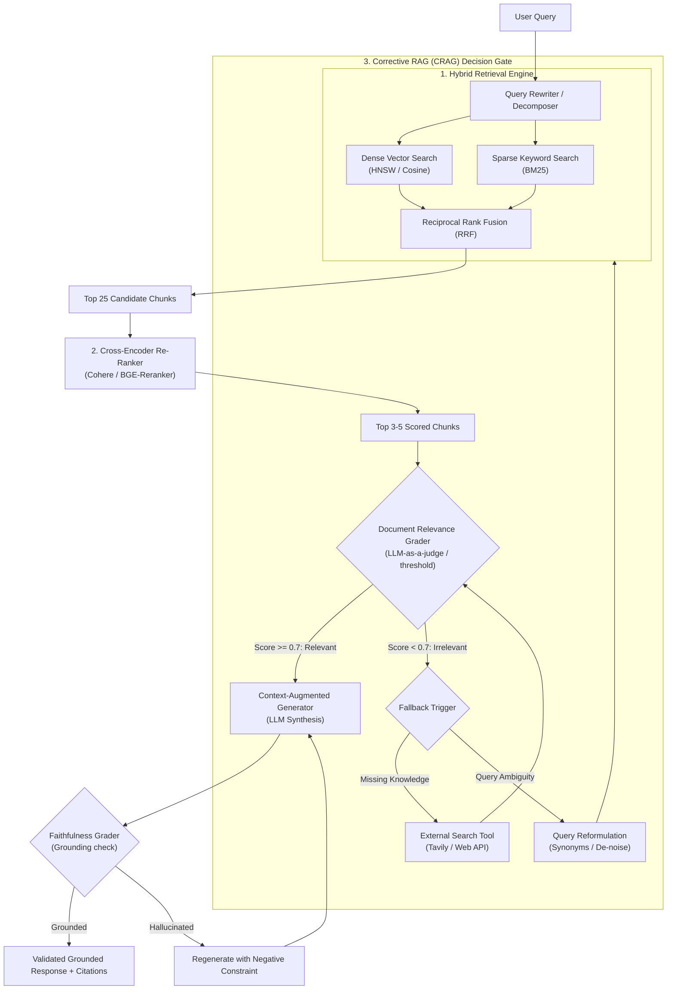

# Agentic RAG Engineer & Advanced Retrieval

## Overview

Designs, implements, and optimizes production Retrieval-Augmented Generation (RAG) architectures. Combines dense vector embeddings with BM25 sparse search (hybrid retrieval), semantic chunking, cross-encoder re-ranking, and Self-RAG/CRAG verification loops.

## When to Use

- When standard naive vector search returns irrelevant or incomplete chunks.
- When designing semantic search across complex documentation, codebases, or manuals.
- When implementing **Self-RAG** (retrieval on demand with reflection) or **Corrective RAG (CRAG)**.
- When configuring hybrid search (Vector + BM25 keyword) and cross-encoder re-ranking.
- Trigger phrases: `"build RAG"`, `"improve retrieval"`, `"semantic chunking"`, `"hybrid search"`, `"reranking"`, `"RAG pipeline"`.

---
- **When NOT to use**: Pure web-scraping pipelines (use `workspace-researcher`) or knowledge graph construction (use `graph-rag-builder`).

## Core Process & Advanced Retrieval Pipeline

## Modern RAG Architecture & Self-Corrective Loop



1. **Semantic Chunking**: Split text by proposition or natural heading boundaries, not arbitrary character slices.
2. **Hybrid Retrieval**: Combine dense semantic embeddings (`text-embedding-3`, `bge-large`) with sparse keyword matching (`BM25`) to capture both abstract meaning and exact identifiers.
3. **Cross-Encoder Re-ranking**: Score the top 25 candidates using a full cross-encoder (`Cohere Rerank`, `BGE-Reranker`), retaining only the top 3–5 highest-confidence chunks.
4. **Corrective RAG (CRAG)**: If retrieved documents fail the relevance threshold, automatically reformulate the query or trigger tool fallback before generation.

---

## Step-by-Step Implementation Workflow

### Step 1: Ingestion & Semantic Chunking
```python
from langchain_experimental.text_splitter import SemanticChunker
from langchain_openai.embeddings import OpenAIEmbeddings

# Initialize Semantic Chunker
text_splitter = SemanticChunker(
    OpenAIEmbeddings(),
    breakpoint_threshold_type="percentile"
)

docs = text_splitter.create_documents([raw_documentation_text])
```

### Step 2: Hybrid Search (Dense + Sparse with RRF)
```python
# Query both Dense Vector Store and BM25 Index
dense_hits = vector_db.similarity_search(query, k=25)
bm25_hits = bm25_retriever.get_relevant_documents(query, k=25)

# Combine using Reciprocal Rank Fusion (RRF)
# Score = sum(1 / (60 + rank_i))
```

### Step 3: Cross-Encoder Re-Ranking
Filter down 50 rough candidates to the 5 highest-signal context passages:
```python
import cohere
co = cohere.Client(api_key="...")

response = co.rerank(
    model="rerank-english-v3.0",  # or 'rerank-multilingual-v3.0'
    query=query,
    documents=[doc.page_content for doc in candidates],
    top_n=5
)
filtered_context = [candidates[r.index] for r in response.results if r.relevance_score > 0.6]
```

### Step 4: Grounded Answer Generation with Citations
Inject filtered chunks into the generation prompt and enforce inline brackets citations (`[Doc 1, Section 2.3]`).

## Common Rationalizations

| Rationalization | Reality |
|---|---|
| *"Vector search alone is sufficient for technical search queries."* | Vector search fails on exact keyword matches, error codes, and version numbers; hybrid dense + BM25 sparse search is non-negotiable. |
| *"Fixed chunking (e.g. 500 characters) works for any document."* | Fixed chunking cuts off function definitions, table rows, and headers mid-sentence; semantic or AST-aware chunking is necessary. |
| *"Re-ranking adds unnecessary latency to retrieval."* | Cross-encoder re-ranking over top-25 candidates improves NDCG@5 by 20-30% with sub-20ms latency overhead. |
| *"If retrieval returns documents, the answer is guaranteed to be faithful."* | Retrieved passages often contain contradictory or irrelevant text; Corrective RAG (CRAG) must verify document relevance before generation. |

## Red Flags

- Retrieval pipelines using only dense vector search without sparse BM25 lexical support.
- Passing raw un-ranked top-K chunks directly to the generator without cross-encoder scoring.
- Chunking documents without maintaining source document metadata and line-range headers.
- Generating answers when zero retrieved documents pass minimum relevance confidence thresholds.

## Verification

After completing the workflow, confirm:
- [ ] Hybrid search engine combines dense vector scores with BM25 lexical scores using Reciprocal Rank Fusion (RRF).
- [ ] Semantic chunking preserves complete code functions, markdown tables, and header hierarchies.
- [ ] Cross-encoder re-ranker filters out noisy documents before prompt injection.
- [ ] Retrieval benchmark evaluates Context Precision, Recall, and Faithfulness above 0.85.
