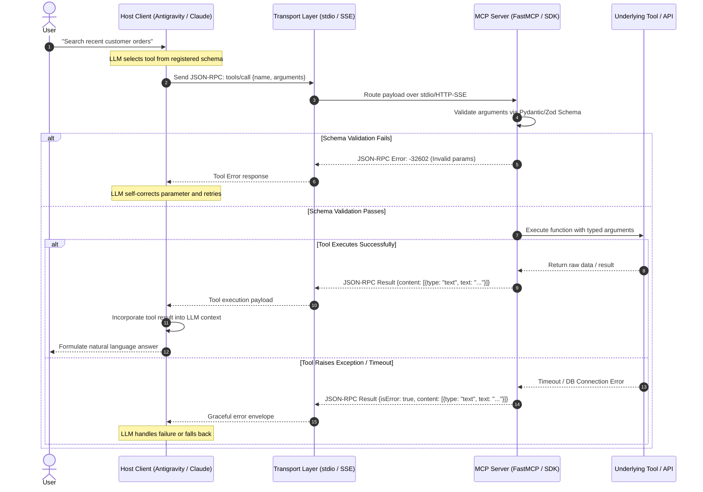

# MCP Tool Integrator & Protocol Engine

## Overview

Designs, implements, and debugs Model Context Protocol (MCP) tool servers and agent tool integrations using FastMCP. Enforces strict Pydantic/Zod tool input schemas, timeout policies, error envelopes, and prevents agent tool hallucinations.

## When to Use

- When building custom MCP servers in TypeScript or Python.
- When exposing local files, databases, or third-party APIs to AI agents.
- When designing tool definitions (names, descriptions, parameter schemas) to maximize tool-calling accuracy.
- When diagnosing tool calling failures, hallucinated arguments, or JSON validation errors.
- Trigger phrases: `"build MCP server"`, `"create agent tool"`, `"tool calling"`, `"function calling schema"`, `"debug tool error"`.
- **When NOT to use**: Designing HTTP REST APIs for human frontends (use `backend-architecture`).

## Core Process & FastMCP Tool Architecture

## MCP Protocol Architecture & Execution Sequence



---

## The Anatomy of an MCP Tool

An MCP tool consists of three vital components:
1. **Name**: Clear, descriptive kebab-case or snake_case identifier (`query_database_records`).
2. **Description**: Concise explanation of what the tool does, when to call it, and formatting constraints.
3. **Input Schema**: Strictly typed JSON Schema generated via Pydantic or Zod with clear field descriptions.

---

## High-Reliability Tool Design Principles

### 1. Self-Documenting Parameter Schemas
Always include descriptions and enum constraints on every parameter:
```python
from pydantic import BaseModel, Field
from typing import Literal

class SearchDatabaseArgs(BaseModel):
    query: str = Field(
        description="The full-text search term to look for in article titles and bodies."
    )
    sort_order: Literal["asc", "desc"] = Field(
        default="desc",
        description="Chronological sort order of returned records."
    )
    limit: int = Field(
        default=10, ge=1, le=50,
        description="Maximum number of records to return (between 1 and 50)."
    )
```

### 2. Defensive Tool Execution & Error Envelopes
Never let tools crash with unhandled tracebacks. Return structured error objects so the agent can self-correct:
```python
def safe_tool_execution(func, *args, **kwargs):
    try:
        result = func(*args, **kwargs)
        return {"status": "success", "data": result}
    except ValueError as e:
        return {"status": "error", "message": f"Invalid argument: {str(e)}", "retryable": True}
    except Exception as e:
        return {"status": "error", "message": f"Fatal tool error: {str(e)}", "retryable": False}
```

### 3. Progressive Token Consumption
- If a tool query returns 5,000 rows, do not dump the raw response into the model's context.
- Implement pagination, summaries, and truncation with clear indicators: `"[Showing 10 of 450 results. Use offset=10 to view more]"`.

---

## Step-by-Step MCP Server Implementation (FastMCP Python)

```python
from mcp.server.fastmcp import FastMCP
from pydantic import BaseModel, Field

# Initialize FastMCP Server
mcp = FastMCP("DataService")

@mcp.tool()
def fetch_user_orders(user_id: str, status: str = "active") -> str:
    """
    Fetch a list of user orders filtered by status.
    Use this tool when the user asks for order history or active purchases.
    """
    # Deterministic query logic
    return f"Orders for {user_id} with status {status}..."

if __name__ == "__main__":
    mcp.run()
```

## Common Rationalizations

| Rationalization | Reality |
|---|---|
| *"Docstrings in tools are just comments; the agent reads the code."* | Agents do NOT read server code; the tool description and parameter docstrings in JSON-RPC schemas are the agent's sole guide to invoking tools correctly. |
| *"Tools can return raw unstructured strings; the LLM will figure it out."* | Unstructured return strings cause parsing errors in automated agent loops; structured JSON returns with status codes are required. |
| *"We don't need timeout handling on tool calls."* | A hanging database query or frozen subprocess will freeze the entire agent session indefinitely without strict timeouts. |
| *"Allowing shell commands in tools without path validation is fine if the user requested it."* | Unrestricted tool execution leads to command injection and unauthorized file tampering; strict path bounds checking is mandatory. |

## Red Flags

- Tool parameters lacking explicit types, default values, or descriptive docstrings.
- Tools returning raw Python tracebacks or unhandled exceptions instead of structured error responses.
- Long-running tool execution without timeout enforcement (maximum 30s recommended for synchronous tools).
- Tool schemas with overlapping or ambiguous descriptions that confuse the agent's tool-selection router.

## Verification

After completing the workflow, confirm:
- [ ] All tools define typed input arguments using Pydantic / Zod models with field descriptions.
- [ ] Tool outputs return structured responses: `{"success": bool, "data": ..., "error": ...}`.
- [ ] Timeout policies and path-traversal safeguards are active and tested.
- [ ] MCP server passes self-test verification: `python mcp_servers/agent_foundry_server.py --test`.
